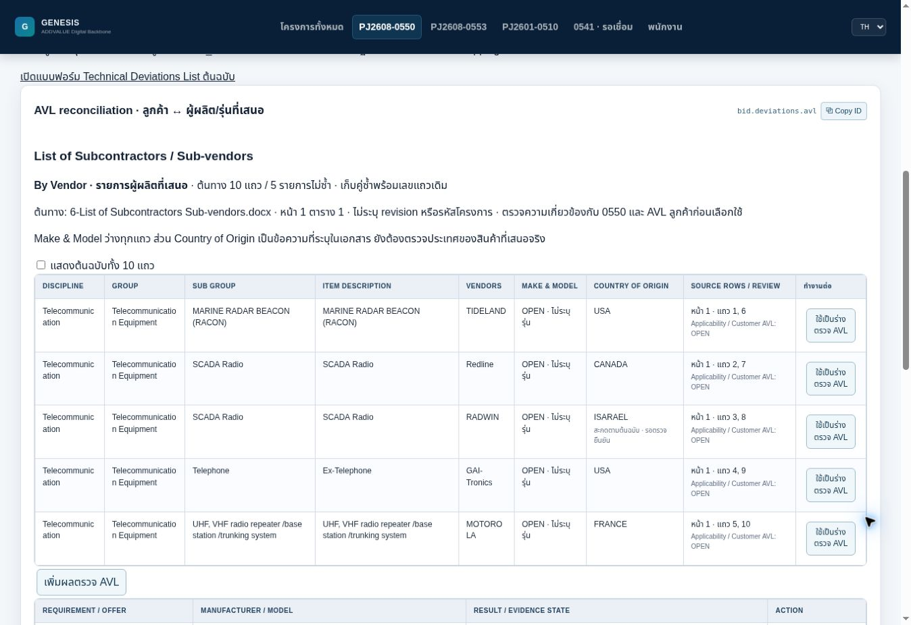

# PJ2608-0550 AVL sub-vendor reference

Date: 29-Oct-2026. UI `2026-10-29.2-preview`.
Target: `PJ2608-0550 / bid.deviations.avl` on the existing Official Working branch.

The user supplied `6-List of Subcontractors Sub-vendors.docx` and explicitly
requested updating this module from it. The attachment snapshot was read directly,
extracted with python-docx and visually checked after rendering its single page.
No original Drive document or attachment was edited. No current-source refresh
was requested or represented as performed.

## Source facts

The document is headed List of Subcontractors/Sub-vendors and By Vendor, with an
Internal footer. It contains one table with seven columns: Discipline, Group,
Sub Group, Item Description, VENDORS, Make & Model, Country of Origin.
Ten data rows form five exact duplicate pairs. Make & Model is blank throughout.
No document revision, project number or customer AVL approval is stated.

| Data rows | Item | VENDORS | Country as written |
|---|---|---|---|
| 1, 6 | MARINE RADAR BEACON (RACON) | TIDELAND | USA |
| 2, 7 | SCADA Radio | Redline | CANADA |
| 3, 8 | SCADA Radio | RADWIN | ISARAEL |
| 4, 9 | Ex-Telephone | GAI-Tronics | USA |
| 5, 10 | UHF, VHF radio repeater /base station /trunking system | MOTOROLA | FRANCE |

`ISARAEL` is preserved verbatim with a review note. Country values are declarations
in this list; they do not establish the manufacturing origin of the offered model.
RACON/SCADA labels do not add customer scope to 0550 or import 0553 requirements.

Provenance: exact mapped Drive file ID `1Qy6PWe1OnSfxLLB4bIoNS2inRoT2N1wf`.
Attachment SHA-256 `f9c69e09cb69019c2987a9e5b641bcee21ed3d62d0eca5595941d191beb1344f`.
The JSON register retains all ten raw cell arrays, line breaks, original spelling,
source row numbers and blank/full-width-space cells. The normal view groups the
five pairs; a checkbox displays all ten original rows without deleting any data.

## Implemented behavior

The source table appears inside the existing AVL module. Selecting a declared
manufacturer prepares a DRAFT/OPEN AVL check, retaining the source row and hash.
It does not select a requirement, offer, customer evidence or approval. Model
remains blank. The user must reconcile project applicability and the exact offer,
then supply current customer AVL evidence through the existing check form.

Optional `vendorListRowId` and `vendorListSourceHash` fields preserve declaration
lineage in AVL backup records. Older backups lacking these fields remain valid.
Reference content participates in the review fingerprint. Unknown/changed source
rows or a manufacturer differing from the declaration reopen review. Even if the
attachment is incorrectly labelled CURRENT_TENDER in source intake, its exact
identity is rejected as customer AVL approval evidence. Existing NOT_LISTED →
accepted-deviation behavior is retained.

No vendor master, selected offer, cost owner, BOM quantity, price, FX, margin or
issued history is changed by opening the list or preparing a draft. The source
reference is not a procurement supplier account or an automatic scope assignment.

## Principles and validation

ADR-0550-001 principles 1–3, 6, 9–10 guide source structuring, exact lineage,
separation of declarations from approval, disclosed gaps and shared records.

Validation includes exact extraction against every attachment table cell and
SHA-256; 10-row/5-group duplicate lineage; preserved spelling/blank models;
DRAFT/OPEN defaults; rejection of the vendor declaration as customer AVL approval;
changed source/manufacturer gates; old backup compatibility; unchanged financial
records; real React rendering; existing bidding regression; production build.
Browser checks and any remaining limits are recorded at completion below.

Customer AVL status, model confirmation, project applicability and actual country
of origin remain OPEN until supported by the relevant project evidence. This
change does not assert that a named manufacturer is approved or rejected.

## Completion verification

- Focused Working/AVL behavior and real React SSR checks passed.
- Existing bidding regression passed; production webpack compiled successfully
  with the existing bundle-size warning. Dependency definitions are unchanged.
- Browser verified UI 2026-10-29.2-preview, five grouped rows, ten original rows,
  source row pairs, Redline draft preparation with blank model/unselected
  requirement/offer and OPEN result, saved lineage at Revision 5, and persistent
  OPEN record after reopening. This used isolated QA storage, not the user's
  localhost database. No source draft was applied to a price or customer scope.
- Exact native-document extraction check passed for all seven column headers,
  all ten raw row cell arrays and the attachment SHA-256.

