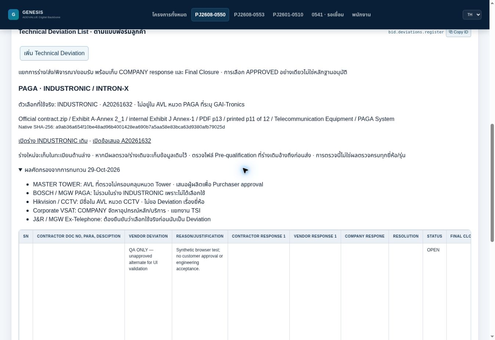

# Selected PAGA AVL deviation

29-Oct-2026 · UI `2026-10-29.3-preview` · existing Official Working branch.

## Result and scope

The user approved implementing the reviewed preview: prepare an AVL deviation
only for a manufacturer actually proposed outside the applicable listed category.
INDUSTRONIC INTRON-X / A20261632 is the confirmed PAGA selection. BOSCH from
MGW is an unselected alternative. MASTER TOWER is the selected tower supplier;
the reviewed AVL has no Telecom Tower category, so its absent name does not
automatically generate an AVL deviation. Purchaser vendor approval is separate.
This is not a full project technical-deviation audit or acceptance of all OEMs.

## Reviewed evidence

- Official contract.zip member: `Exhibit A-Annex 2_1 VENDORS and SUBCONTRACTORS.pdf`.
  Source intake ID `ARC-c58c78bee91525a7d51265b1`. Native 21-page file MD5
  `d7d45dbf6162bcb928276235b4bc514a` matches the existing archive inventory.
  SHA-256 `a9ab36a654f10be48ad96b4001428ea690b7a5aa58e83bca63d9380afb79025d`.
  PDF p13 / printed p11 of 12, internal Exhibit J Annex-1, Telecommunication
  Equipment → PAGA System → GAI-Tronics. Native page rendered and inspected.
- INDUSTRONIC technical offer A20261632 and existing selected OEM records.
- `Attachment 3 TechnicalDeviationsListTemplate-IND.xlsx`, SN1, already requests
  acceptance of INDUSTRONIC outside Annex-2. Its pre-qualification attachment
  reference is retained; exact attachment completeness has not been verified.
- The archived native documents and full private source-intake payload remain
  outside Git. Only the bounded reviewed locator/fact and draft are implemented.

## Implementation

`avlDeviationBasis0550.js` prepares one linked requirement, NOT_LISTED AVL check
and DRAFT/PENDING deviation in the existing integration workspace. The selected
PAGA package and additive components of A20261632 share one manufacturer request;
the request retains all those offer IDs and linked Working lines. The dedicated
AVL requirement is anchored to the primary package, not a claim that its technical
design passes. Its proof mode is NOT_REQUIRED for this manufacturer-only question;
the existing system engineering obligations and release gates remain in force.

The existing provider saves this additive preparation on load after the vendor/MR
catalogue migrations. It does not depend on the Drive Desktop bridge being online.
Existing equivalent deviation/checks, occupied stable IDs and user decisions are
preserved. Repeated loads do not duplicate the draft. A different selected OEM or
mixed quote basis does not create an INDUSTRONIC draft. Existing drafts remain
editable; changed selections require review, not automatic deletion/replacement.

No source authority, review signature, query/transmittal date, customer response,
closure or approval is fabricated. Source intake may still contain the AVL member
as metadata-only; its full review/authority checks must be completed before those
gates can close. This implementation supplies a justified draft, not an accepted
deviation. Technical equivalence, full engineering adequacy and missing attachments
are not approved by the source fact.

Existing module IDs `bid.deviations.avl` and `bid.deviations.register` are retained.
The register displays workflow progress separately from the derived acceptance
gate: DRAFT is visibly an unsent request; APPROVED text without required evidence
does not display accepted closure. Review problems remain available in disclosures.
Selected-basis source links and the bounded screening notes from the preview are
shown inside the existing register. Those dated notes are not a live audit of all
other brands if their selection changes later.

## Principles and verification

ADR-0550-001 principles 1–3, 6, 9–12 apply: usable source facts, interpretation
separation, selected-offer trace, disclosed gaps, preserved user edits/history,
canonical saved records and evidence-aware UI. The reviewed category fact is
separate from approval. No quantity, rate, FX, margin, cost owner, selected supplier,
frozen snapshot or issued history is modified.

Focused checks cover new/existing workspaces; unchanged financials; selected OEM
and quote grouping; mixed selection; idempotence; preserved edits/equivalent IDs
and prior AVL decisions; pending approval; schema/backup compatibility; real React
register rendering. Existing Working and Bidding regression checks pass. Production
build and browser results are recorded below.

## Completion checks

- Working/AVL tests and Bidding regression passed. Real React SSR renders the
  seeded request inside the unchanged register module. Whole-workspace schema
  validation accepts the saved draft without a new persisted schema field.
- Production webpack build passed with the existing asset-size warning.
- Browser verified UI `.3-preview`, additive draft preparation in isolated QA
  storage (Revision 6), selected INDUSTRONIC/NOT_LISTED/result distinction, edit
  and save (Revision 7), and full page re-entry. The edit persisted, Revision 7
  did not change on repeated load, and exactly one seeded request remained.
  Existing unrelated QA records were preserved. This is not the user's Windows
  database or a customer submission.
- Reusing the action on an AVL check opens its existing linked request rather
  than creating another request for that same check/offer.
- Source authority/version checks, exact pre-qualification attachment linkage,
  complete project technical review and customer acceptance remain outstanding.
  No customer release or merge is authorized by this change.

