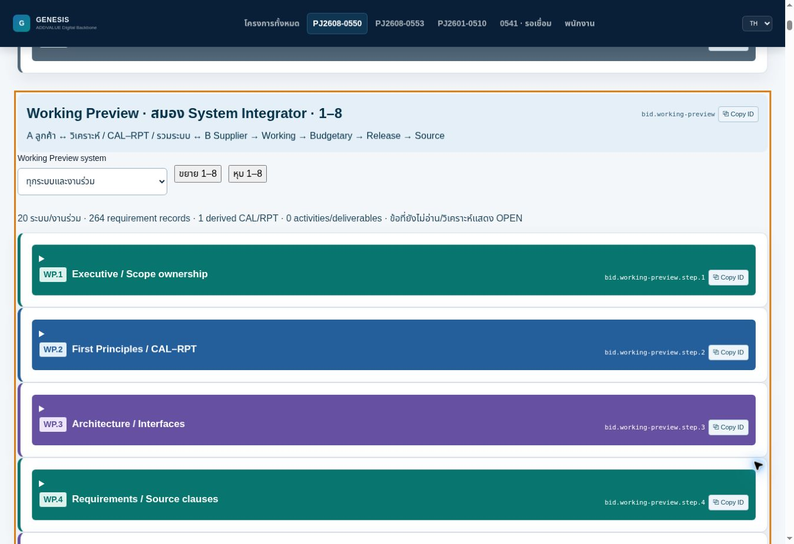

# PJ2608-0550 — Working Preview 1–8 / System Particular / AVL–Deviation

Date: 29-Oct-2026 (Asia/Bangkok). UI `2026-10-29.1-preview`.
Branch: `feat/pj2608-0550-official-working-20261028`.
Continue from this implementation; do not recreate the workspace or substitute 0553 data.

## User-visible result

Budget → Working Preview now contains WP.1–WP.8 with stable IDs
`bid.working-preview.step.1` through `.8`. Each has its purpose, input,
method, output, limitation, workflow colour, accordion and Copy ID.

| Step | Work performed in the shared workspace |
|---|---|
| 1 | Customer document coverage, every system and COMMON scope review |
| 2 | Derived CAL/RPT, source-backed method and inputs, criteria and limitations |
| 3 | Architecture / interface and responsibility basis |
| 4 | Clause requirements, customer sources, supplier evidence and allocation |
| 5 | Existing physical BOM / quantities and cost owners |
| 6 | Installation, integration, people, ITP, VDRL/SDRL and lifecycle deliverables |
| 7 | Customer ↔ integrator ↔ supplier reconciliation and reverse offer mapping |
| 8 | Gaps, changed dependencies, Working readiness and internal JSON backup |

`bid.working-preview.particulars` holds notes, appendices, addenda, coloured
text and other system particulars. One record retains multiple exact source
references, visual-review locators, affected requirements, lifecycle obligations
and affected steps. The same record projects into all selected Working steps.
Colour is a reason to inspect the original, not a rule for document precedence.
Conflicting particulars remain OPEN. Training/FAT/SAT/PRECOM/spares/warranty and
other applicable obligations require allocated activities with ownership and
acceptance/deliverable information; they do not post additional costs themselves.

The document reading ledger records reviewed page ranges and separate checks
for notes, colour and appendices. Importing text alone cannot mark a document
fully reviewed. Text discovery produces obligation candidates, not approved facts.

The AVL / Deviation tab uses the user-supplied Technical Deviations List fields,
including CONTRACTOR/VENDOR/COMPANY responses, Resolution and Final Closure.
NOT_LISTED needs an accepted linked deviation. Technical deviations unrelated
to AVL also keep their linked requirement OPEN until resolved. APPROVED/CLOSED
labels alone cannot replace approval evidence.

## Persistence, compatibility and controls

The optional `integrationWorkspace` v1 extension is saved in the existing
IndexedDB workspace and included in backup/import. The canonical MR seed still
contains 264 records across 19 systems plus COMMON; it is an initial coverage
basis, not a statement that all customer clauses have been extracted. Additional
requirements and systems can extend that denominator. Old records, module IDs,
source versions and historical outputs remain intact.

The live provider passes the integration projection into Official pricing even
before the first integration save. Missing requirement/proof/activity/AVL/particular
coverage prevents a reviewed Official output. Existing standalone legacy model
calls retain compatibility; callers that need the new controls must pass the
integration model or provide `integrationWorkspace`. Final release remains HOLD.

Changes to referenced source content, requirements, offers, calculations,
particulars and linked allocations invalidate affected reviews. Same-revision
copies with differing or unread content require reconciliation. Review fingerprints
are change detectors, not authenticated approval signatures. CAL results remain
separate from field/FAT/SAT test acceptance. Derived CAL/RPT never overwrites
received CAL/RPT evidence.

Working price rows and mapped offers link back to their requirement and CAL/RPT
basis. Existing Release → Working navigation is retained. New-ID generation
supports preview origins that expose getRandomValues without randomUUID.

## Verification performed

- Full `npm run build`: validation chain passed (173 PASS output entries), followed
  by production webpack compilation. Existing bundle-size warning remains.
- After final navigation changes: Working Preview behavior/SSR test and the
  existing bidding validator passed again; production compilation passed again.
- Behavior tests cover source/excerpt/visual/full-page gates; changed inputs and
  stale reviews; CAL units and negative margins; NOT_LISTED and technical deviation
  gates; lifecycle gaps; unknown values; backup validation; UUID fallback; real
  React modules; reverse links; unchanged financial inputs and frozen history.
- Isolated cloud-browser QA: Working module-ID navigation, PAGA filter, saving
  a CAL draft as OPEN, saving a deviation draft as OPEN, a two-reference Particular
  projected into all eight steps, and JSON download with all new collections.
  Reopening the application retained Revision 4 and its new records. The final
  build also passed price-row → requirement navigation and expand/collapse checks.
  Browser test records are explicitly labelled QA ONLY and are not project data.
- Downloaded browser backup retained 273 existing Working lines and 139 offers,
  plus the test proof, particular and deviation; both particular references and
  all eight affected steps survived export.
- Private source compatibility check: existing Rev03 intake with 484 source
  records validates and derives 264 requirements / 20 systems-and-shared scopes.
  Readiness remains false, Release HOLD. Measured model derivation was 341 ms in
  this environment; this is not an end-to-end browser performance guarantee.

## Actual limits — next engineering work

Software controls and saved forms are implemented. This checkpoint does not
assert that all pages of the 484 documents, every highlighted note, every customer
clause, or every MGW/INDUSTRONIC catalog/datasheet have been reviewed and mapped.
There are no actual project-derived engineering proofs approved by this change.
Method, input-source explanation, acceptance criteria, visual locators and reviews
still require engineering work; the software does not infer their truth from text.
Existing data availability is not missing scope and does not justify requesting
previously supplied files again. Continue reading the existing sources and filling
these canonical records; keep actual unresolved items OPEN.

The private source intake remains runtime data loaded through the existing Drive
Desktop bridge. It is not bundled in Git. Pulling this software alone cannot
transport local browser inputs or an unreviewed document-reading ledger. No new
price, quantity, FX or commercial margin is posted. No customer issue or branch
merge is authorized by this checkpoint.

## Principles applied

ADR-0550-001: 1–3 (structured evidence and bidirectional mapping), 4–6
(scope, lifecycle ownership and disclosed gaps), 8–11 (shared projections,
change tracking and preserved output history), 12 (visible principles, colour,
accordions and Copy ID), 13–14 (all-system coverage and separate CAL/RPT proof).
The checks above establish their implemented software boundaries; the actual
project-wide engineering conclusions remain subject to source review.

## Windows review

Use the existing 0550 review checkout on this branch. Stop its development
server, pull with `--ff-only`, enter `frontend`, run `npm ci` when dependencies
need restoring, then `npm start -- --port 3001`. Open the project and confirm
UI `2026-10-29.1-preview`. Keep the existing Hub checkout and browser backups.

QA screenshot (synthetic test workspace, not an engineering completion report):

